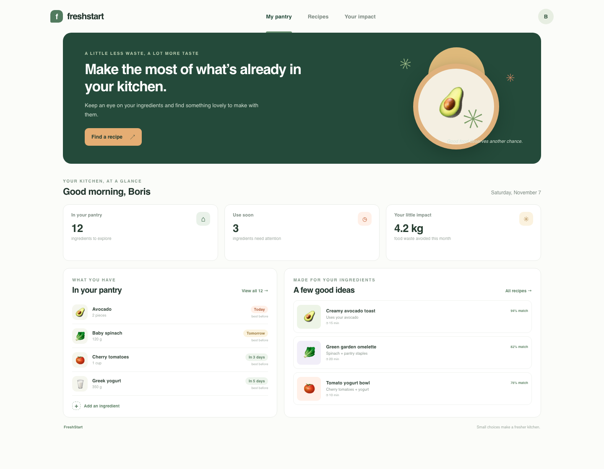
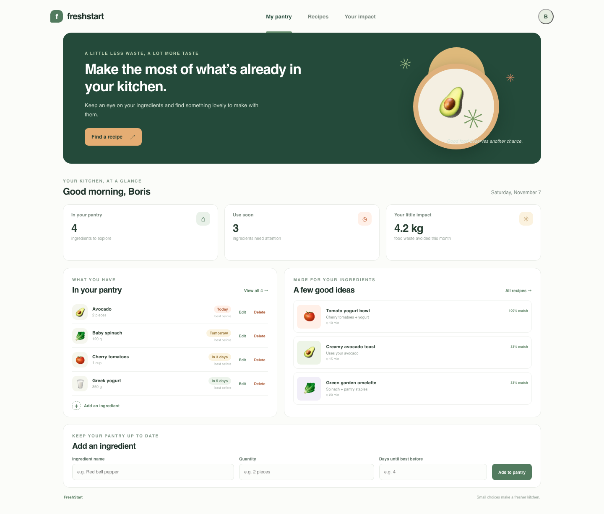
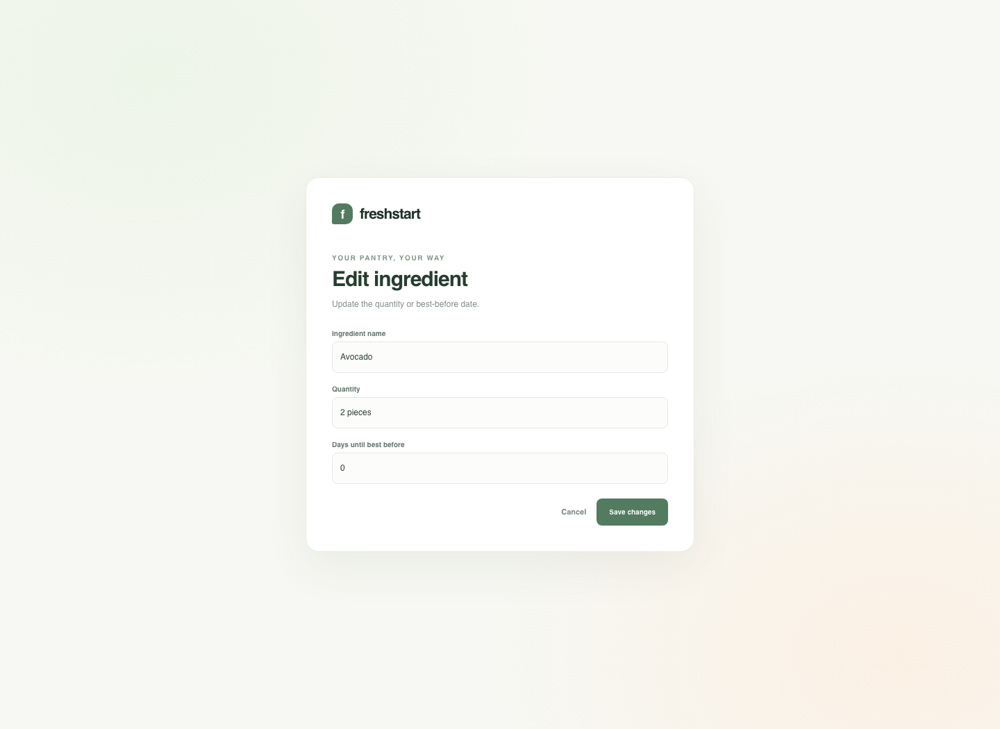
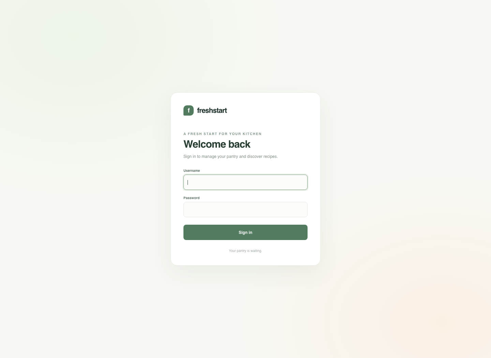

# FreshStart

<p align="center">
  <strong>A small, functional-minded web app for a fresher kitchen.</strong><br />
  Track ingredients, notice what to use soon, and find recipes that match what is already in the pantry.
</p>

<p align="center">
  
  
  
</p>

---

## Contents

- [Project idea](#project-idea)
- [What it can do](#what-it-can-do)
- [Screenshots and report milestones](#screenshots-and-report-milestones)
- [How the project is structured](#how-the-project-is-structured)
- [Functional programming in FreshStart](#functional-programming-in-freshstart)
- [Technology](#technology)
- [Run it locally](#run-it-locally)
- [Configuration](#configuration)
- [Using the app](#using-the-app)
- [Data model](#data-model)
- [Routes](#routes)
- [Current scope and limitations](#current-scope-and-limitations)
- [Project tree](#project-tree)

## Project idea

Food is often thrown away because it is easy to forget what is in the fridge or when it should be used. FreshStart is a single-user pantry dashboard that keeps a lightweight inventory, highlights ingredients that need attention, and ranks a few recipe ideas by how many listed ingredients are available.

The project is intended as a medium-sized functional programming course project. Its scope connects pure functions and algebraic data types with a practical web interface and persistent document storage.

## What it can do

- Show pantry ingredients, quantities, and best-before timing.
- Add an ingredient after validating its name, quantity, and number of days.
- Edit or delete an existing ingredient.
- Confirm a deletion in the browser before submitting it.
- Count ingredients that should be used soon.
- Rank sample recipes by the percentage of their ingredients currently in the pantry.
- Sign in and sign out using a single account configured locally.
- Save pantry records in MongoDB Atlas, or use in-memory sample data when Atlas is not configured.
- Keep existing Atlas records usable by assigning an application ID to older documents when they are loaded.

## Screenshots and report milestones

The screenshots below are also a ready-made order for a project report. Each milestone describes the implementation and points to the screenshot that demonstrates it.

### Milestone 1 — Dashboard and page structure

The first version introduced the FreshStart dashboard, with a pantry overview, summary cards, recipe suggestions, and a responsive page layout.



### Milestone 2 — Pantry and recipe domain logic

Pure functions classify best-before timing, count ingredients that need attention, calculate recipe match percentages, and sort recipe suggestions. Keeping these rules separate from HTTP handlers makes the core behavior easier to follow.


### Milestone 3 — Validated ingredient entry

The ingredient form was connected to the domain validation function. Empty names and quantities, invalid day counts, and negative values are rejected before a pantry item is added.


### Milestone 4 — MongoDB Atlas persistence

Pantry data can be stored in the Atlas `pantry` collection. The local configuration stays in `.env`, which is excluded from version control. If the database collection is empty, sample ingredients are inserted for the first launch.


### Milestone 5 — Editing and deleting ingredients

Each pantry row has separate Edit and Delete actions. The edit screen reuses the same validation rules as ingredient creation. Delete requires a browser confirmation and removes only the selected item.



### Milestone 6 — Ingredient editing form

The edit page loads the selected pantry record into a focused form. The update uses the original item ID and passes through the same validation used when creating a pantry item.



### Milestone 7 — Sign-in form and protected dashboard

The dashboard and pantry actions require a signed-in session. The login form checks the locally configured account, the session cookie is marked `HttpOnly` and `SameSite=Lax`, and the logout action invalidates the server-side session.



> Screenshots are stored in the repository so they can be inserted directly into the course report.

## How the project is structured

FreshStart follows a small layered design:

1. **Domain layer** — data types and pure pantry/recipe rules.
2. **Storage layer** — an in-memory implementation for local development and a MongoDB Atlas implementation for persistence.
3. **Web layer** — Scotty routes, request validation, authentication checks, and Lucid HTML rendering.
4. **Presentation layer** — responsive CSS in `static/style.css`.

This keeps rendering and database calls at the application edges, while the main calculations remain ordinary functions over values.

## Functional programming in FreshStart

The project uses several practical functional programming ideas:

- **Algebraic data types:** `PantryItem`, `Recipe`, and `ExpiryStatus` describe valid concepts explicitly.
- **Pure functions:** expiry classification, urgency labels, attention counts, and recipe ranking do not access the network, database, or clock.
- **Explicit failure:** `validatePantryItem` returns `Either Text PantryItem`, so invalid input is represented as a value that the caller must handle.
- **Immutable transformations:** recipe lists are ranked by producing a new ordered list; pantry updates produce updated item values.
- **Higher-order functions:** `map`, `filter`, and `sortOn` express common collection operations.
- **Effects at the boundary:** HTTP handling and MongoDB access live in `IO`, while calculations in `FreshStart.Domain` remain pure.

## Technology

| Area | Choice |
| --- | --- |
| Language | Haskell |
| HTTP server and routing | Scotty |
| HTML rendering | Lucid |
| Database | MongoDB Atlas |
| Styling | Plain CSS |
| Build tool | Cabal |

The MongoDB Haskell driver is vendored under `vendor/mongoDB` and locally patched to validate TLS server certificates using the operating system certificate store. Its upstream Apache-2.0 license is included with the vendored source.

## Run it locally

### Requirements

- GHC and Cabal, normally installed through GHCup.
- A MongoDB Atlas cluster if persistent cloud storage is desired. Without `MONGODB_URI`, the app uses in-memory sample data.

### Setup

1. Clone the repository and open its root directory.
2. Copy `.env.example` to `.env`.
3. Fill in the settings described below. Keep `.env` private and do not commit it.
4. Build and run the application:

```sh
set -a
source .env
set +a
cabal run
```

5. Open <http://localhost:3000/login> in a browser.

The first build may take longer while Cabal resolves and compiles dependencies. Stop the server with `Ctrl+C` in the terminal where it is running.

## Configuration

| Variable | Required | Purpose |
| --- | --- | --- |
| `MONGODB_URI` | No | Atlas connection string. If omitted, the app uses in-memory sample data. |
| `APP_USERNAME` | Yes for sign-in | Username for the single local account. |
| `APP_PASSWORD` | Yes for sign-in | Password for the single local account. |
| `APP_COOKIE_SECURE` | No | Set to `true` when serving through HTTPS so the session cookie gets the `Secure` attribute. Keep `false` for local HTTP. |

The example file contains placeholders only. Put real values in `.env`. The database user in the URI must have access to the Atlas cluster, and the client IP must be allowed in the Atlas network access list.

When `MONGODB_URI` is present, the application authenticates to Atlas using SCRAM-SHA-1 and verifies TLS certificates. The vendored driver's SCRAM-SHA-256 path did not authenticate with the configured Atlas user in this environment, while SCRAM-SHA-1 did. The database name is read from the URI; if no name is provided, `freshstart` is used. Pantry documents are stored in the `pantry` collection.

## Using the app

1. Sign in with `APP_USERNAME` and `APP_PASSWORD`.
2. Review the pantry dashboard and recipe match percentages.
3. Add an ingredient with its quantity and days until its best-before date.
4. Choose **Edit** on a pantry row to update its details.
5. Choose **Delete** and confirm to remove the selected record.
6. Choose the profile button to sign out.

The number of days is validated as a non-negative integer. Items with three days or fewer remaining are included in the attention count.

## Data model

Each pantry document contains an application ID, emoji, name, amount, and number of days until its best-before date. The application ID is separate from MongoDB's own `_id` and is used by edit/delete actions. Older records are assigned this field on load, so existing pantry data remains available after the update.

The `Recipe` type contains a name, description, duration, ingredient list, and visual style. Recipe matching compares ingredient names without case sensitivity and calculates the share of required ingredients found in the pantry.

## Routes

| Method | Path | Purpose | Access |
| --- | --- | --- | --- |
| `GET` | `/login` | Show sign-in form | Public |
| `POST` | `/login` | Validate credentials and create a session | Public |
| `POST` | `/logout` | Invalidate the current session | Signed in |
| `GET` | `/` | Show pantry and recipe dashboard | Signed in |
| `POST` | `/pantry` | Validate and add a pantry item | Signed in |
| `POST` | `/pantry/edit` | Open an item's edit form | Signed in |
| `POST` | `/pantry/update` | Validate and save changes | Signed in |
| `POST` | `/pantry/delete` | Delete a pantry item | Signed in |
| `GET` | `/style.css` | Serve the stylesheet | Public |

## Current scope and limitations

- Authentication is a single account configured through environment variables; there is no user registration or password reset.
- Sessions are held in memory and are cleared when the server restarts. The project is an educational prototype, not a production identity system.
- A production deployment should use HTTPS, secure secret management, password hashing, rate limiting, and a maintained session/authentication library.
- The recipe collection is currently a small in-code sample. Recipes are ranked but are not loaded from MongoDB.
- Food-waste impact is currently illustrative dashboard content, not a measured calculation.

## Project tree

```text
app/
├── Main.hs                    # Scotty routes and Lucid pages
└── FreshStart/
    ├── Domain.hs              # Pantry and recipe types and pure rules
    └── MongoStore.hs          # In-memory and Atlas storage
static/
└── style.css                  # Responsive interface styles
screenshots/                   # Milestone evidence for the report
vendor/mongoDB/                # Vendored Haskell MongoDB driver
.env.example                  # Safe configuration template
```

## License

The project is distributed under the repository's [LICENSE](LICENSE). The vendored MongoDB driver retains its upstream license in `vendor/mongoDB`.
